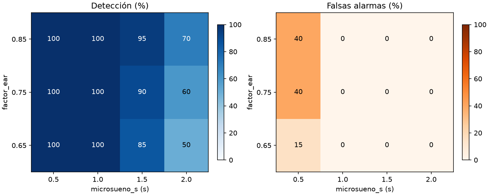
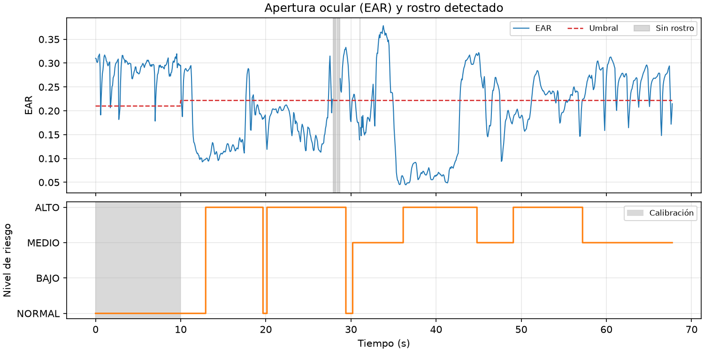
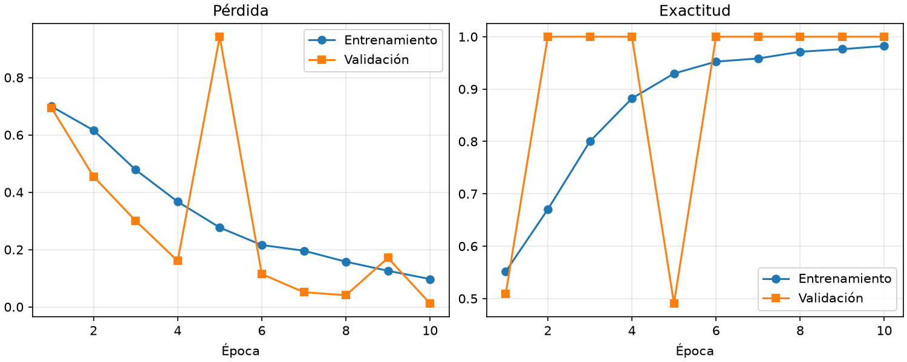

# Informe borrador: DriveGuard Lab

> Borrador. Reúne los resultados de `resultados/` y la bitácora (`docs/bitacora_agentica.md`). Las respuestas a las preguntas de análisis las redacta el estudiante.

## Resumen

- Se verificó el entorno (21 de 22 comprobaciones correctas; la API no estaba levantada).
- Los 7 escenarios sintéticos corren contra el motor de riesgo con `ConfigRiesgo` por defecto; 1 de 7 llega a emergencia (`sin_respuesta`).
- El barrido de umbrales (20 conductores sintéticos) recomienda microsueno_s = 1.0 s y factor_ear = 0.85 (100.0 % de detección, 0.0 % de falsas alarmas); los valores por defecto dan 90.0 % de detección.
- La CNN de ojos alcanza 100.0 % en prueba, pero en el video etiquetado predice una sola clase (exactitud 50.0 %); EAR obtiene 40.4 %.
- Las etiquetas del video no coinciden con la señal de EAR; los resultados de video y CNN no son concluyentes.

## Método

- **Entorno:** Python 3.11.16 en `win32`; mediapipe 1.2.0, opencv-contrib-python 5.0.0.93, torch 2.15.0, pytest 9.2.0 (detalle en `resultados/entorno.md`). Modelo `face_landmarker.task`.
- **Semilla fija:** 42 (escenarios, umbrales y CNN).
- **`ConfigRiesgo`:** valores por defecto de `core/config.py`, sin modificar. Los experimentos que varían umbrales usan instancias aparte.
- **Escenarios:** los 7 de `core/simulacion.py` (normal, cansancio, microsueno, sin_respuesta, distraccion, cabeceos, rostro_ausente).
- **Umbrales:** 20 conductores sintéticos; EAR base 0.25-0.38, ruido 0.005-0.025, parpadeo normal de 0.10 a 0.70 s cada 3-6 s, cierre de microsueño de 1.2 a 3.0 s (inicio en t=20 s).
- **Video:** `prueba.mp4` (1017 fotogramas, 67.7 s, ≈15.0 fps), propio; solo se guardan métricas.
- **CNN:** recortes propios de `ojos`, 10 épocas, Adam (lr 1e-3), lote 32, partición temporal 70/15/15 (entrenamiento 1010, validación 216, prueba 216).
- **EAR vs CNN:** `ojos_etiquetado.mp4`, 450 de 600 fotogramas evaluados.

## Resultados

### Entorno (`resultados/entorno.md`)

21 de 22 comprobaciones correctas. Única falla: API (`http://127.0.0.1:8000`) no disponible (ConnectTimeout); MongoDB (localhost:27017) respondió correctamente.

### Escenarios (`resultados/escenarios.md`, `resultados/escenarios.csv`)

| Escenario | Duración (s) | Nivel máximo | Primer instante (s) | Motivos | Emergencia | Instante emergencia (s) |
|---|---:|:---:|---:|---|:---:|---:|
| normal | 60 | NORMAL | 10.00 | - | no | - |
| cansancio | 100 | MEDIO | 40.00 | cansancio_perclos,bostezos | no | - |
| microsueno | 40 | ALTO | 21.53 | microsueno | no | - |
| sin_respuesta | 50 | ALTO | 21.53 | microsueno,cansancio_perclos | sí | 31.53 |
| distraccion | 40 | MEDIO | 23.00 | distraccion | no | - |
| cabeceos | 60 | MEDIO | 40.47 | cabeceos | no | - |
| rostro_ausente | 40 | MEDIO | 23.00 | rostro_ausente | no | - |

Escenarios con emergencia: 1 de 7.

### Umbrales (`resultados/umbrales.md`, `resultados/umbrales.csv`, `resultados/umbrales_detalle.csv`)

| microsueno_s | factor_ear | Detección (%) | Falsas alarmas (%) | Latencia media (s) |
|---:|---:|---:|---:|---:|
| 0.5 | 0.65 | 100.0 | 15.0 | 0.53 |
| 0.5 | 0.75 | 100.0 | 40.0 | 0.50 |
| 0.5 | 0.85 | 100.0 | 40.0 | 0.44 |
| 1.0 | 0.65 | 100.0 | 0.0 | 1.03 |
| 1.0 | 0.75 | 100.0 | 0.0 | 0.99 |
| 1.0 | 0.85 | 100.0 | 0.0 | 0.93 |
| 1.5 | 0.65 | 85.0 | 0.0 | 1.56 |
| 1.5 | 0.75 | 90.0 | 0.0 | 1.52 |
| 1.5 | 0.85 | 95.0 | 0.0 | 1.46 |
| 2.0 | 0.65 | 50.0 | 0.0 | 1.99 |
| 2.0 | 0.75 | 60.0 | 0.0 | 1.97 |
| 2.0 | 0.85 | 70.0 | 0.0 | 1.90 |

Recomendación (tope de 5 % de falsas alarmas): **microsueno_s = 1.0 s y factor_ear = 0.85**, con 100.0 % de detección, 0.0 % de falsas alarmas y latencia media de 0.93 s. Los valores por defecto (1.5 s y 0.75) dan 90.0 % de detección y 0.0 % de falsas alarmas. Resultado sobre datos sintéticos; no se cambian los valores por defecto sin confirmación.

### Video propio (`resultados/video.md`)

`prueba.mp4`: rostro detectado en 98.9 % de los fotogramas; calibración en los primeros 9.9 s; emergencia: no.

| Nivel | % de fotogramas |
|---|---:|
| NORMAL | 7.3 |
| BAJO | 0.0 |
| MEDIO | 36.0 |
| ALTO | 56.7 |

| Motivo | Fotogramas | % |
|---|---:|---:|
| cabeceos | 564 | 65.1 |
| cansancio_perclos | 417 | 48.1 |
| microsueno | 368 | 42.4 |
| cabeza_caida | 180 | 20.8 |

PENDIENTE: comparación contra el guion del video (no hay guion en `resultados/video.md`).

### CNN (`resultados/cnn.md`)

- Exactitud (prueba): 100.0 % sobre 216 recortes. Inferencia: 1.25 ms por fotograma (un recorte, CPU, mediana).
- Última época: entrenamiento pérdida 0.0971, exactitud 0.982; validación pérdida 0.0123, exactitud 1.000.

| Clase | Precisión | Recall | F1 | Soporte |
|---|---:|---:|---:|---:|
| cerrado | 1.000 | 1.000 | 1.000 | 110 |
| abierto | 1.000 | 1.000 | 1.000 | 106 |

| | pred. cerrado | pred. abierto |
|---|---:|---:|
| **real cerrado** | 110 | 0 |
| **real abierto** | 0 | 106 |

Limitación: todos los recortes provienen de una misma persona y sesión; la exactitud no anticipa el desempeño con otros conductores, cámaras o iluminación.

### EAR vs CNN (`resultados/ear_vs_cnn.md`)

Video `ojos_etiquetado.mp4`; ojos cerrados etiquetados en 10-20 s y 30-35 s. Se evalúan 450 de 600 fotogramas (225 cerrados, 225 abiertos).

| Método | Exactitud | F1 cerrado | F1 abierto | Recall cerrado | Precisión cerrado |
|---|---:|---:|---:|---:|---:|
| EAR | 40.4 % | 0.350 | 0.451 | 0.320 | 0.385 |
| CNN | 50.0 % | 0.667 | 0.000 | 1.000 | 0.500 |

| EAR | pred. cerrado | pred. abierto |
|---|---:|---:|
| real cerrado | 72 | 153 |
| real abierto | 115 | 110 |

| CNN | pred. cerrado | pred. abierto |
|---|---:|---:|
| real cerrado | 225 | 0 |
| real abierto | 225 | 0 |

- Tramos (>= 1 s) en que EAR detecta ojos cerrados: 10.0-14.3 s, 23.7-27.6 s, 36.3-39.9 s; no coinciden con las etiquetas.
- Probabilidad media de cerrado de la CNN: 0.82 en tramos etiquetados cerrados y 0.85 en abiertos.
- La CNN predice una sola clase: su F1 de cerrado es trivial. Causa probable: recortes de entrenamiento oscuros (media 38/255) y clases capturadas en tandas separadas.

## Comparación Claude Code vs OpenCode

Solo la etapa de umbrales tiene ambas herramientas. "Tiempo hasta verde" es la duración de la etapa.

| Campo (E3.3 umbrales) | Claude Code | OpenCode |
|---|---|---|
| Modelo | Sonnet 5.5 | Big Pickle (OpenCode Zen) |
| Rama | lab/solarte-emmanuel | lab/solarte-emmanuel-oc |
| Duración (min) | 5 (9:29 a 9:34) | 4 (10:16 a 10:20) |
| Costo | No separable por tarea | USD 0; 58.5K tokens |
| Intervenciones humanas | 0 | 0 |
| Iteraciones fallidas | 0 | 0 |
| Pruebas nuevas | 2 | 1 |
| Errores graves | Sin errores graves | — |
| Recomendación | 1.0 s y factor 0.85 | 1.0 s y factor 0.75 |
| Detección con valores por defecto | 90 % | 75 % |

Otras etapas (solo Claude Code, Sonnet 5.5):

| Etapa | Duración (min) | Intervenciones | Pruebas |
|---|---:|---:|---|
| Configuración (9:08 a 9:26) | 18 | 2 | — |
| Experimentos (9:38 a 9:56) | 18 | 1 | pytest de 45 a 61 |

Costo de Claude Code (sesión completa, no separable por tarea): USD 1.72 a precios de API (Sonnet 1.24, Opus 0.48, Haiku 0.0004); 25 % del cupo de la sesión de 5 h de Claude Pro. El subagente `revisor-seguridad` (Opus) representó el 18 % del uso de las últimas 24 h.

Nota: OpenCode reporta 75 % de detección con los valores por defecto y Claude Code 90 %; `resultados/umbrales.md` (rama de Claude Code) da 90.0 %. PENDIENTE: no hay archivos de resultados de la rama OpenCode para contrastar esa diferencia.

## Qué salió mal y cómo se detectó

- **MCP de mongodb (configuración):** aparecía `failed` en `/mcp` por timeout de `npx` al arrancar; detectado por ejecución; corregido instalándolo global.
- **Modo plan (experimentos):** el agente quedó en modo plan y la herramienta de plan dio error al cambiar de modo; requirió una intervención humana.
- **CNN sin discriminar (experimentos):** 100 % en prueba pero predice "cerrado" en todo el video (recortes oscuros, tandas separadas); detectado al compararla con el video etiquetado.
- **Etiquetas del video:** no coinciden con el guion; cerrados reales en 10.0-14.3, 23.7-27.6 y 36.3-39.9 s.
- **Revisión de seguridad:** `revisor-seguridad` sin hallazgos en la etapa de configuración.

## Limitaciones y ética

- Prototipo académico; las cifras de escenarios y umbrales provienen de datos sintéticos y no se generalizan a conductores reales.
- Video y CNN: una sola persona, un solo entorno y 450 fotogramas útiles; las etiquetas del video no coinciden con la señal.
- No se guardan imágenes de rostros en el repositorio; solo métricas numéricas.
- Notificaciones simuladas (`NOTIFICACIONES_SIMULADAS=true`); no se usaron credenciales.

## Conclusiones

PENDIENTE: escrita por el estudiante (incluye las respuestas a las preguntas de análisis).

## Fuentes

Usadas: `resultados/entorno.md`, `escenarios.md`, `escenarios.csv`, `umbrales.md`, `umbrales.csv`, `umbrales_detalle.csv`, `umbrales.png`, `video.md`, `video.png`, `cnn.md`, `cnn_curvas.png`, `ear_vs_cnn.md`, `docs/bitacora_agentica.md`.

Faltantes: ninguno de los cuatro esperados. Pendientes: prompts clave de la bitácora, conclusión, guion del video, resultados de la rama OpenCode.
